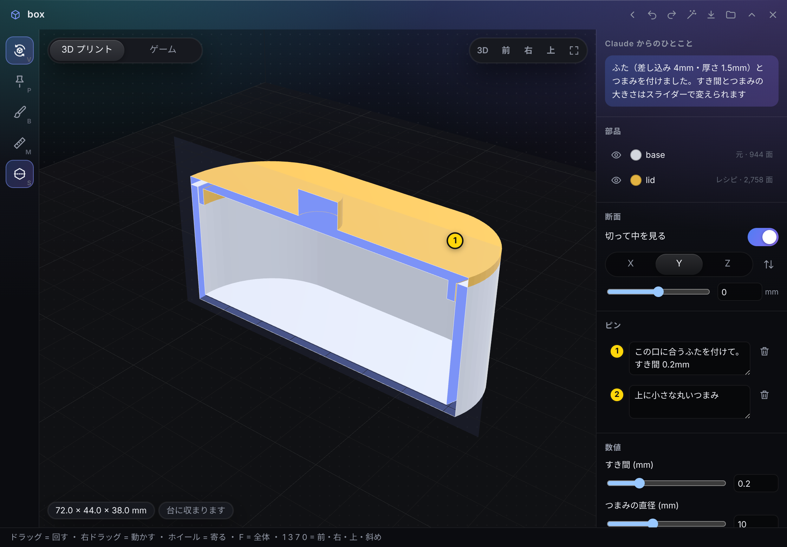
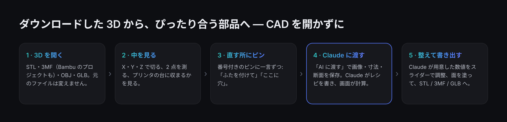
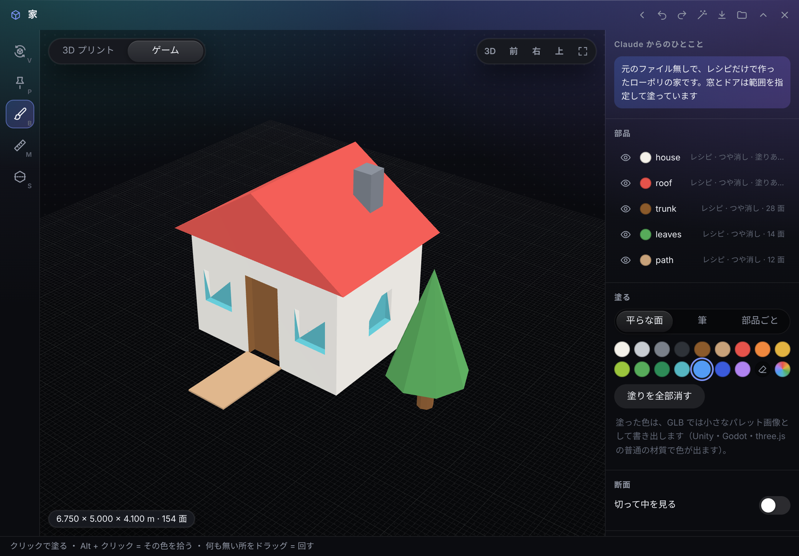

<p align="center"></p>

# モデルスケッチ（Model Sketch）

<p align="center"><a href="README.md">English</a> · <b>日本語</b></p>

Windows のデスクトップの端に置くバー **[Hub](https://github.com/satosugarforwork44x-lang/desktop-hub)** の拡張アプリです。
3D のファイルをすぐ開き、**切って中を見て**、**直してほしい所にピン**を置くと、**Claude** がふた・穴・つまみなどの形を
小さな「レシピ」で足し、画面がその場で計算して見せます。面に色を塗り、**3D プリント**（STL / 3MF）や**ゲーム**（GLB）向けに書き出せます。
元のファイルは変えません。



> ライセンス: [PolyForm Noncommercial 1.0.0](LICENSE) — 個人など営利目的でない利用は自由です。
> 画面の見本の 3D（箱と、レシピだけで作った家）は、この README のために作ったものです。

## 作った理由

家で小物を 3D プリントしたり、ゲーム用の簡単な小道具を作ったりします。そのとき、いつも時間がかかるのは 3D の部分でした。

- **スライサーは「印刷のための道具」で、「見る道具」ではない。** Bambu Studio や Cura は層やサポートを見せてくれますが、壁の厚さやふたが合うかを確かめるには CAD を開くことになります
- **ちょっとした変更に CAD は重い。** 「この箱にふたを」「ここに 3mm の穴を」— 5 分の思いつきが、一晩のモデリングになります
- **チャットの AI は 3D を見られないし、指させない。** Claude にふたを頼むことはできても、Claude は形を見られず、こちらも「ここ」と示せません

そこでモデルスケッチは、**Hub の中の「3D の下書き台」**にしました。スライサーや CAD とは、あえて競いません。

- **Hub が「目」と「指」になる。** 寸法・断面の輪郭・ピンの位置を測り、4 方向の画像を作って渡すので、Claude は推測ではなく正確な数値で作れます
- **Claude が書くのはコードではなくレシピ。** `{"op": "lid", "of": "base", "clearance": "$clearance"}` — 画面が manifold で計算し、すぐ表示します。AI が書いたものをプログラムとして動かすことはありません
- **調整のつまみは手元に。** Claude が `params` にした値はスライダーになります。すき間を 0.2 から 0.3mm に変えるのに、頼み直す必要はありません



## UX で決めたこと

| 決めたこと | 理由 |
|---|---|
| **スライサーにならない** | 層・サポート・印刷時間は、スライサーがすでに（無料で）よくできています。モデルスケッチはその手前の「見る・切る・指す・変える」を受け持ちます |
| **断面を「測る道具」の中心にする** | ふたが合うかは、口の形が正確に分かるかで決まります。縁の高さで切れば輪郭が数値で取れ、それが Claude に要るもの。だから断面はキー 1 つ（`S`）とスライダーで |
| **Claude はデータを書き、計算は画面がする** | 決まった操作のレシピなので安全に動かせて、手順ごとに分かりやすいエラー（「手順 3: 部品 lid がありません」）を返せ、普通の編集と同じく元に戻せます |
| **説明の代わりにピン** | 「*この*壁を厚く」を番号付きのピンで。ピンの 3D の位置がメモと一緒に Claude に渡ります |
| **2 種類の使い手を 1 つの切り替えで** | 「3D プリント」はプリンタの台・mm・オーバーハング、「ゲーム」は地面の格子・m・三角形の数。道具は同じで、出す数値と書き出しだけが変わります |
| **塗りは画素ではなく手順で持つ** | 色は「どこを・何色に」（平らな面・上向きの面・範囲・筆の跡）で保存するので、形を計算し直しても残ります。Claude も同じ書き方で塗れます |
| **ゲームの色はパレット画像で** | GLB では、色を小さなパレット画像にまとめ、UV で指します。Unity・Godot・three.js の普通の材質で正しく色が出ます（頂点の色は専用のシェーダーが要ることが多い） |
| **押せる物はすべて画面に、キーも表示** | これまでの Hub アプリの反省です。左の道具に `V P B M S` を表示し、視点のボタンも画面に置き、右クリックで「ここにピン・ここで断面・隠す」 |
| **上書きしない** | 書き出しは `name (2).stl`。自分の変更も Claude の変更も `Ctrl+Z` で戻せます |

## できること

| 機能 | 中身 |
|---|---|
| **開く** | STL、3MF（形を別のファイルに置く Bambu Studio / PrusaSlicer のプロジェクトも）、OBJ、GLB / glTF（Draco・meshopt の圧縮も）。GLB は m・Y が上から直して表示 |
| **見る** | 回す・動かす・寄る、前・右・上・斜めの視点、寸法、プリンタの台に収まるか（Bambu Lab・Prusa・Creality・Anycubic・自分で入力） |
| **断面**（`S`） | X / Y / Z で切る。スライダーか `Shift` + ホイール。切り口は色で埋まる |
| **ピン**（`P`） | 番号付きのピンにメモ。3D の位置と一緒に Claude へ |
| **測る**（`M`） | 2 点の距離と ΔX / ΔY / ΔZ |
| **レシピ** | `box`・`cylinder`・`sphere`・`polygon`・`union`・`subtract`・`intersect`・`translate`・`rotate`・`scale`・`mirror`・`copy`・`place`・`cut`・**`lid`**・`hide`。`params` と `"$wall*2+1"` のような簡単な式 |
| **塗る**（`B`） | 平らな面・筆・部品ごと、消しゴム、スポイト（`Alt` + クリック）、16 色＋好きな色 |
| **材質** | プラスチック・つや消し・光沢・金属 |
| **プリント向け** | オーバーハング（45° 超）の表示、体積 |
| **書き出し**（`Ctrl+E`） | STL（1 つに / 部品ごと）、3MF（部品ごとの物体・mm）、GLB（m・Y が上・原点は底の中心・パレット画像） |
| **空から作る** | ファイルが無くても、Claude にレシピで部品や小道具を作ってもらえる |
| **英語・日本語** | 画面は両方の言葉に対応 |



## はじめ方

**Hub 0.8 以降**が必要です。Python のパッケージは要りません。3D の表示（three.js）と形の計算（manifold の WebAssembly 版）を同梱していて、画面の中で動きます。

1. このリポジトリを Hub のモジュールのフォルダに **`model` という名前で**置きます（フォルダ名はモジュールの id と同じにします）
   ```bat
   git clone https://github.com/satosugarforwork44x-lang/model-sketch "%LOCALAPPDATA%\Hub\modules\model"
   ```
2. Hub を起動し直すと、バーに **モデルスケッチ**（立方体のアイコン）が出ます。3D のファイルを窓に落とすか、`.stl` / `.3mf` / `.obj` / `.glb` を「プログラムから開く」で開きます。
   データはフォルダ窓の置き場所の **`Model Sketch`** フォルダに保存され、そのままフォルダ窓にもなります
3. （任意）Claude に読み書きさせるには: Hub の設定（⚙）→ Claude 連携 で `Model Sketch` を **読み書き** にし、**画像も見せる** を ON にします

## キー

| キー | 道具 | キー | 操作 |
|---|---|---|---|
| `V` | 回す・選ぶ | `Ctrl+Z` / `Ctrl+Y` | 元に戻す / やり直す |
| `P` | ピン | `Ctrl+E` | 書き出し |
| `B` | 塗る | `0` `1` `3` `7` | 斜め・前・右・上 |
| `M` | 測る | `F` | 全体 |
| `S` | 断面の入り切り | `Shift` + ホイール | 断面を動かす |
| `Alt` + クリック | 色を拾う（塗る） | `Delete` | 選んだピンを消す |

## Claude と使う

ピンを置いてメモを書き、**AI に渡す**（杖のアイコン）を押します。画面が `_ai/<名前>.png`（ピンの番号入りの 4 方向の画像）と
`_ai/<名前>.json`（部品の寸法・ピン・断面の輪郭・レシピのエラー）を保存し、Claude に貼る頼みの文をコピーします。そのまま頼んでもかまいません。

- 「モデルスケッチの `box` を見て、すき間 0.2mm のふたを付けて。すき間はスライダーにして」
- 「台の中心に、下から 3mm の穴を貫通させて」
- 「天板を木の茶色、脚を濃いグレーの金属にして」
- 「空のモデルから: 5mm のケーブルをはさむ、30mm のケーブルクリップを作って」

Claude は [`MODEL_FORMAT.md`](MODEL_FORMAT.md)（フォルダに自動で置かれます）を読み、`.model.json` を書き換えます。
寸法が足りなければ、`measure` に断面を足して測ってもらえます。画面は数秒で計算し直し、元に戻すこともできます。

```jsonc
{
  "format": "hub-model/1",
  "purpose": "print",
  "source": { "path": "D:/3D/box.stl", "scale": 1, "upY": false },
  "params": { "clearance": { "value": 0.2, "min": 0, "max": 0.8, "step": 0.05, "label": "すき間 (mm)" } },
  "steps": [
    { "op": "lid", "of": "base", "id": "lid", "clearance": "$clearance" },
    { "op": "cylinder", "id": "knob", "d": 10, "h": 6, "at": [0, 0, 32] },
    { "op": "union", "from": "lid", "with": ["knob"] }
  ],
  "parts": { "lid": { "color": "#E3B341" } },
  "paint": [ { "of": "lid", "color": "#8B5A2B", "where": { "normal": "up" } } ],
  "pins":  [ { "id": 1, "p": [20, 20.5, 26], "n": [0, -1, 0], "part": "base", "text": "この口に合うふたを付けて" } ],
  "section": { "on": true, "axis": "y", "at": 0 }
}
```

**できないこと:** 元の形の面を変える（角を丸める・壁の厚さを変える）、キャラクターのような有機的な形。
足す・引くには、閉じた（穴の無い）形が必要です。閉じていない形でも、見る・切る・ピン・塗るはできます。

## しくみ

| 部分 | 役割 |
|---|---|
| `manifest.json` | Hub のモジュール定義（`moduleApi 1`、Hub 0.8 以上）: 窓、立方体のタイル、3D ファイルの「プログラムから開く」、ファイルを渡す `/blob/model/…`、書き出しと AI 用ファイルの `upload` |
| `api.py` | モデルスケッチを開いて検査（読めない所は警告して読み飛ばす）、壊れない保存、上書きしない書き出しと AI 用ファイル |
| `ui/viewer.js` | three.js の表示（mm・Z が上）、変わったときだけ描く、切り口を埋めた断面、ピン、測る、AI 用の画像 |
| `ui/loaders.js` | STL / OBJ / GLB は three.js で。**3MF は自前の小さな読み込み**で、Bambu Studio / PrusaSlicer の「形を別のファイルに置く」作りにも対応 |
| `ui/recipe.js` | レシピを manifold（WebAssembly）で計算、AI 用の断面の輪郭 |
| `ui/paint.js` | 塗りの手順 → 三角形ごとの色（平らな面の塗りつぶし、向き、範囲、三角形までの距離で判定する筆） |
| `ui/export.js` | バイナリ STL、3MF、パレット画像付きの GLB |
| `ui/panel.js` | 窓: 道具、右の欄、キー、保存、外で書き換えられたときの読み直し |
| `MODEL_FORMAT.md` | Claude 向けに書いたデータの形 |

- **データが正。** `.model.json` が唯一の元です。画面は更新時刻を見ているので、Claude の変更はそのまま表示に出ます
- **Python の形の計算パッケージを使わない。** 作者の PC は Python 3.15 で、manifold3d や trimesh がまだ入りませんでした。同じ計算の WebAssembly 版を画面で動かすことで、Python の版に左右されないようにしました
- **作る前に、測って確かめた。** 実装の前に、核になる考えを小さく試しました。Hub が箱を縁の高さで切って輪郭を数値で渡し、その数値だけでふたを作る — 重なりゼロで収まりました

## 開発

```bat
py -m unittest discover -s tests -v
```

## ライセンス

**[PolyForm Noncommercial 1.0.0](LICENSE)** — **個人・学習・研究など営利目的でない用途**なら、使う・読む・改変する・共有するのは自由です。
商用の利用はできません。商用で使いたい場合は作者に連絡してください。

`ui/vendor/` に同梱しているもの（import の書き方以外は変えていません）:

| ライブラリ | 用途 | ライセンス |
|---|---|---|
| [three.js](https://threejs.org/) r170 | 3D の表示、STL / OBJ / GLB の読み込み、GLB の書き出し | MIT |
| [manifold](https://github.com/elalish/manifold) 3.5.4（`manifold-3d`） | 足す・引く・断面（WebAssembly） | Apache-2.0 |
| Draco decoder（three.js 経由） | 圧縮された GLB | Apache-2.0 |
| fflate（three.js 経由） | 3MF（zip）の読み書き | MIT |
| meshoptimizer decoder（three.js 経由） | 圧縮された GLB | MIT |

ロゴ（`assets/`）も、このリポジトリと同じライセンスです。
