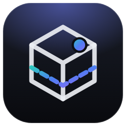
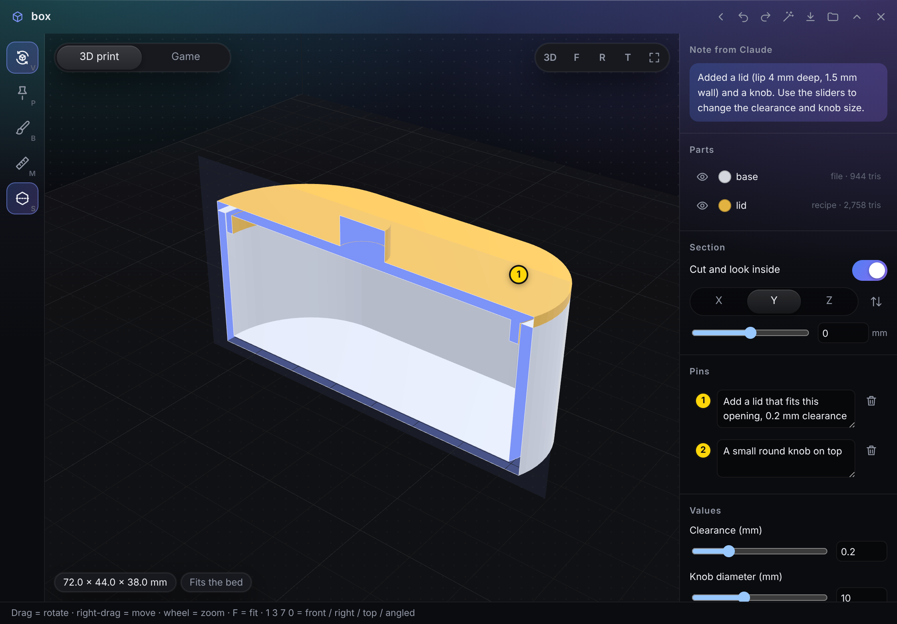
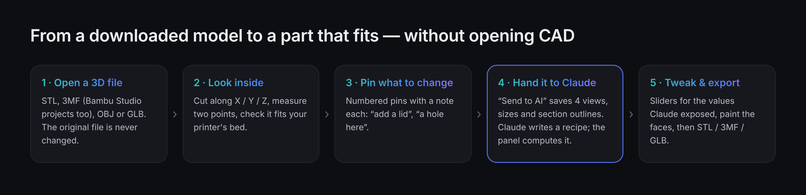
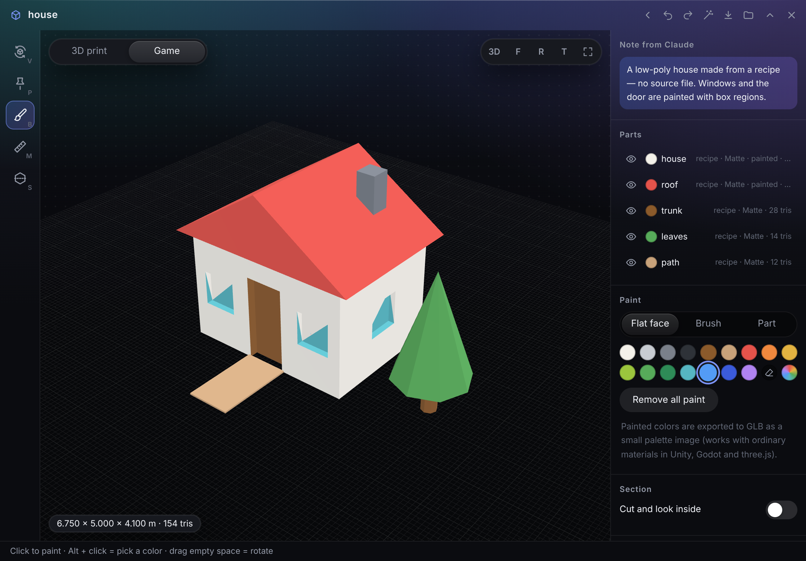

<p align="center"></p>

# Model Sketch

<p align="center"><b>English</b> · <a href="README.ja.md">日本語</a></p>

An extension app for **[Hub](https://github.com/satosugarforwork44x-lang/desktop-hub)**, the slim bar on the edge of your Windows desktop.
Open a 3D file instantly, **cut it open to look inside**, **pin what you want changed**, and let **Claude** add the shapes —
a lid that fits, a hole, a knob — as a small recipe that the panel computes on the spot. Paint the faces and export for
**3D printing** (STL / 3MF) or for **games** (GLB). The original file is never touched.



> License: [PolyForm Noncommercial 1.0.0](LICENSE) — free for personal and other non-commercial use.
> The sample models in the screenshots were made for this README (a box and a recipe-only house).

## Why I built this

I print small things at home and sometimes make simple props for games. The 3D part of that was always the slow part:

- **Slicers are for printing, not for looking.** Bambu Studio or Cura show layers and supports, but checking a wall thickness or whether a lid will fit means jumping into CAD.
- **CAD is heavy for tiny changes.** "Add a lid to this box", "put a 3 mm hole here" — a five-minute idea becomes an evening of modelling.
- **Chat AIs can't see or point in 3D.** You can ask Claude for a lid, but it can't look at your model, and you can't show it *where*.

So Model Sketch is a **3D sketch table that sits in Hub**, one click away. It deliberately does not compete with slicers or CAD:

- **Hub is the eyes and the finger.** It measures the model (sizes, section outlines, pin positions) and renders four views, so Claude gets exact numbers instead of guesses.
- **Claude writes a recipe, not code.** `{"op": "lid", "of": "base", "clearance": "$clearance"}` — the panel computes it with manifold and shows it a moment later. Nothing an AI writes is executed as code.
- **You keep the dials.** Values Claude exposes as `params` become sliders: change the clearance from 0.2 to 0.3 mm without asking again.



## UX decisions

| Decision | Why |
|---|---|
| **Don't be a slicer** | Layers, supports and print time are already done well (and for free) by slicers. Model Sketch covers the gap before that: look, cut, point, change |
| **The section is the main measuring tool** | A lid only fits if the opening is known exactly. Cutting at the rim gives the outline as numbers, which is what Claude needs — so sectioning is one key (`S`) and a slider |
| **Claude writes data, the panel computes** | A recipe of fixed operations is safe to run, gives a clear error per step ("step 3: part *lid* not found"), and can be undone like any edit |
| **Pins instead of descriptions** | "Make *this* wall thicker" with a numbered pin on the model, and the pin's 3D position goes to Claude with your note |
| **One switch for two audiences** | *3D print* shows the printer bed, mm and overhangs; *Game* shows a ground grid, metres and triangle counts. Same tools, different numbers and exports |
| **Paint as steps, not pixels** | Colours are stored as "where and which colour" (a flat face, faces facing up, a box, brush strokes), so they survive when the shape is recomputed — and Claude can paint the same way |
| **Game colours as a palette image** | GLB exports put the colours into a tiny palette texture with UVs. It looks right with ordinary materials in Unity, Godot and three.js (vertex colours often need a special shader) |
| **Every tool is a visible button with its key** | A lesson from the previous Hub apps: `V P B M S` are on the tool rail, the view buttons are on screen, and right-click offers *Pin here / Section here / Hide* |
| **Nothing is overwritten** | Exports become `name (2).stl`; every change — yours or Claude's — can be undone with `Ctrl+Z` |

## Features

| Feature | What it does |
|---|---|
| **Open** | STL, 3MF (including Bambu Studio / PrusaSlicer projects that keep meshes in separate files), OBJ, GLB / glTF (Draco and meshopt compressed too). GLB is converted from metres / Y-up |
| **Look** | Orbit, pan, zoom, front / right / top / angled views, size readout, *fits the bed* check with printer presets (Bambu Lab, Prusa, Creality, Anycubic or custom) |
| **Section** (`S`) | Cut along X / Y / Z with a slider or `Shift` + wheel; the cut face is filled with colour |
| **Pins** (`P`) | Numbered pins with a note each, sent to Claude with their 3D position |
| **Measure** (`M`) | Distance between two points, with ΔX / ΔY / ΔZ |
| **Recipe** | `box`, `cylinder`, `sphere`, `polygon`, `union`, `subtract`, `intersect`, `translate`, `rotate`, `scale`, `mirror`, `copy`, `place`, `cut`, **`lid`**, `hide` — with `params` and simple expressions like `"$wall*2+1"` |
| **Paint** (`B`) | Flat face, brush and whole-part modes, eraser, eyedropper (`Alt` + click), 16 colours + any colour |
| **Materials** | Plastic, matte, glossy, metal |
| **Print helpers** | Overhang view (over 45°), volume |
| **Export** (`Ctrl+E`) | STL (one file or one per part), 3MF (parts as objects, mm), GLB (metres, Y-up, origin at the bottom centre, palette texture) |
| **Start empty** | No file needed: ask Claude to build a part or a prop from a recipe |
| **Delete** | Trash button on a card (or right-click), or at the bottom of the side panel; click twice. Goes to the Recycle Bin with its AI files — the original 3D file and exports are kept |
| **English & Japanese** | The panel is available in both languages |



## Getting started

Requires **Hub 0.8 or later**. No Python packages are required — the 3D view (three.js) and the geometry engine (manifold, WebAssembly) are bundled and run inside the panel.

1. Put this repository into Hub's module folder **as `model`** (the folder name must match the module id):
   ```bat
   git clone https://github.com/satosugarforwork44x-lang/model-sketch "%LOCALAPPDATA%\Hub\modules\model"
   ```
2. Restart Hub. **Model Sketch** (the cube icon) appears on the bar. Drop a 3D file onto the panel, or use *Open with* on `.stl` / `.3mf` / `.obj` / `.glb`.
   Your sketches are kept in a **`Model Sketch`** folder next to your folder panels, so it also becomes a folder panel.
3. (Optional) To let Claude read and change them: Hub Settings (⚙) → Claude integration → set `Model Sketch` to **read & write** and turn on **Let Claude view images**.

## Keys

| Key | Tool | Key | Action |
|---|---|---|---|
| `V` | Rotate / select | `Ctrl+Z` / `Ctrl+Y` | Undo / redo |
| `P` | Pin | `Ctrl+E` | Export |
| `B` | Paint | `0` `1` `3` `7` | Angled / front / right / top view |
| `M` | Measure | `F` | Fit |
| `S` | Section on / off | `Shift` + wheel | Move the section |
| `Alt` + click | Pick a colour (paint) | `Delete` | Remove the selected pin |

## Working with Claude

Place pins, write what you want, and press **Send to AI** (the wand). The panel saves `_ai/<name>.png` (four views with pin numbers)
and `_ai/<name>.json` (part sizes, pins, section outlines, recipe errors) and copies a request you can paste to Claude. Or just ask:

- "Look at `box` in Model Sketch and add a lid with 0.2 mm clearance. Make the clearance a slider."
- "Put a 3 mm hole through the centre of the base, from the bottom."
- "Paint the table top wood-brown, the legs dark grey and make the legs metal."
- "Start an empty model: a 30 mm cable clip that snaps onto a 5 mm cable."

Claude reads [`MODEL_FORMAT.md`](MODEL_FORMAT.md) (copied into your folder automatically), then edits the `.model.json` file.
If it needs a measurement, it can ask for one by adding a section to `measure`. The panel recomputes within a couple of seconds, and you can undo it.

```jsonc
{
  "format": "hub-model/1",
  "purpose": "print",
  "source": { "path": "D:/3D/box.stl", "scale": 1, "upY": false },
  "params": { "clearance": { "value": 0.2, "min": 0, "max": 0.8, "step": 0.05, "label": "Clearance (mm)" } },
  "steps": [
    { "op": "lid", "of": "base", "id": "lid", "clearance": "$clearance" },
    { "op": "cylinder", "id": "knob", "d": 10, "h": 6, "at": [0, 0, 32] },
    { "op": "union", "from": "lid", "with": ["knob"] }
  ],
  "parts": { "lid": { "color": "#E3B341" } },
  "paint": [ { "of": "lid", "color": "#8B5A2B", "where": { "normal": "up" } } ],
  "pins":  [ { "id": 1, "p": [20, 20.5, 26], "n": [0, -1, 0], "part": "base", "text": "Add a lid that fits this opening" } ],
  "section": { "on": true, "axis": "y", "at": 0 }
}
```

**What it can't do:** reshape the original surfaces (fillet edges, change wall thickness) or make organic shapes like characters.
Adding and subtracting needs a closed (watertight) model; open models can still be viewed, cut, pinned and painted.

## How it works

| Piece | Role |
|---|---|
| `manifest.json` | Hub module definition (`moduleApi 1`, Hub ≥ 0.8): panel, cube tile, *Open with* for 3D files, `/blob/model/…` for files, `upload` for exports and AI files |
| `api.py` | Opens and validates sketches (anything unreadable is skipped with a warning), atomic saves, exports and AI files without overwriting |
| `ui/viewer.js` | three.js view in mm with Z up, render-on-demand, section plane with filled cut, pins, measuring, snapshots for the AI |
| `ui/loaders.js` | STL / OBJ / GLB via three.js loaders; **3MF with its own small reader** that follows Bambu Studio / PrusaSlicer's separate object files |
| `ui/recipe.js` | Runs the recipe with manifold (WebAssembly), section outlines for the AI |
| `ui/paint.js` | Paint steps → a colour per triangle (flat-face flood fill, normals, boxes, brush by distance to the triangle) |
| `ui/export.js` | Binary STL, 3MF, and GLB with a palette texture |
| `ui/panel.js` | The panel: tools, side panel, keys, saving, reloading when the file changes outside |
| `MODEL_FORMAT.md` | The format, written for Claude |

- **Data first.** The `.model.json` file is the single source of truth. The panel polls its modification time, so Claude's edits just appear.
- **No Python geometry packages.** The author's PC runs Python 3.15, where packages like manifold3d and trimesh weren't available yet. The same engine runs as WebAssembly in the panel instead, so the app doesn't depend on the Python version.
- **Measured, not guessed.** Before building anything, the author checked the core idea in a quick experiment: Hub cuts the box at the rim, passes the outline as numbers, and a lid is built from those numbers alone — it fitted with zero overlap.

## Development

```bat
py -m unittest discover -s tests -v
```

## License

**[PolyForm Noncommercial 1.0.0](LICENSE)** — free to use, read, modify and share for **personal, study, research and other non-commercial purposes**.
Commercial use is not permitted. For commercial use, please contact the author.

Bundled in `ui/vendor/` (unchanged except for import paths):

| Library | Used for | License |
|---|---|---|
| [three.js](https://threejs.org/) r170 | 3D view, STL / OBJ / GLB loaders, GLB export | MIT |
| [manifold](https://github.com/elalish/manifold) 3.5.4 (`manifold-3d`) | Adding, subtracting, sections (WebAssembly) | Apache-2.0 |
| Draco decoder (via three.js) | Compressed GLB | Apache-2.0 |
| fflate (via three.js) | Reading and writing 3MF (zip) | MIT |
| meshoptimizer decoder (via three.js) | Compressed GLB | MIT |

The logo (`assets/`) is covered by the same license as this repository.
